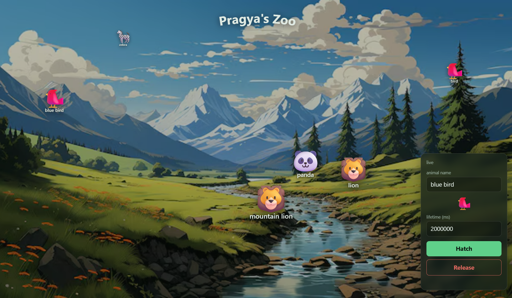

# Terrarium: A Container Runtime Ecosystem



A small container runtime built from scratch on Linux namespaces and cgroups v2. Containers are "creatures": each is hatched into its own PID, mount and UTS namespace, chrooted into an Alpine rootfs, and capped by a memory cgroup. Go over the limit and the kernel OOM-kills it, making the creature go dormant. State lives in SQLite, a FastAPI service controls the runtime over REST, and a polling web dashboard shows it all.

## Architecture

```
 Dashboard (HTML/JS)  --polls every 2s-->  FastAPI (api/main.py)
                                             |            |
                                 reads state |            | spawns / SIGKILLs
                                             v            v
                                  SQLite (terrarium.db)  isolate (C++ binary)
                                             ^            |
                                             +-- writes --+
                                                          v
                                          clone(NEWPID|NEWNS|NEWUTS)
                                          chroot + /proc, cgroup v2 memory.max
```

- **`src/`** is the C++ runtime. `container.cpp` does `clone()`, rootfs copy, chroot, `/proc` mount and cgroup setup. `creatures.cpp` is the SQLite layer. `isolate.cpp` is the CLI (`hatch`, `list`).
- **`api/main.py`** is the REST layer. It reads the DB directly and shells out to `isolate` to hatch.
- **`dashboard/`** is a static page served by the API itself.

## How it works

- **Isolation:** `clone()` with `CLONE_NEWPID | CLONE_NEWNS | CLONE_NEWUTS`. The creature sees itself as PID 1 and can't see host processes. Each creature gets its own copy of the Alpine template, deleted on exit.
- **Memory limit:** a cgroup at `/sys/fs/cgroup/terrarium-<pid>/` gets `memory.max` set and the child's PID written to `cgroup.procs`. Exceeding the limit triggers a kernel OOM-kill (SIGKILL), which `isolate` detects via `WIFSIGNALED` and records as `SLEEPING`.
- **States:** `ALIVE` (running), `SLEEPING` (OOM-killed), `RELEASED` (exited cleanly or released via the API).

## Prerequisites

This runtime uses Linux-only features (PID namespaces, cgroups), so it needs a real Linux environment:

- Native Linux, **or** WSL2 on Windows
- `g++`, `make`, `libsqlite3-dev`
- Python 3 with `venv`

## Setup

```bash
# 1. Build the isolate binary
make

# 2. Create a venv and install the API deps
python3 -m venv .venv
.venv/bin/pip install -r api/requirements.txt
```

You also need an Alpine minirootfs extracted to `/root/terrarium/template` (x86_64 shown):

```bash
sudo mkdir -p /root/terrarium/template && curl -L https://dl-cdn.alpinelinux.org/alpine/v3.24/releases/x86_64/alpine-minirootfs-3.24.1-x86_64.tar.gz | sudo tar -xz -C /root/terrarium/template
```

## Running it

The runtime needs **root** — `isolate` sets up cgroups and namespaces, and reads/writes state under `/root/terrarium` (template rootfs, per-creature dirs, the SQLite DB). Run the API server as root:

```bash
sudo .venv/bin/uvicorn api.main:app --host 0.0.0.0 --port 8000
```

Then open **http://localhost:8000/** — the API serves the dashboard itself (mounted as static files at `/`), so it's all one origin and there's no CORS setup needed.

## Using it

- Fill in the **Hatch** form (name and time) and submit; that POSTs to `/terrarium/hatch`.
- The dashboard polls `/terrarium` every 2s and shows each creature on the stage, grayed out once it is sleeping.
- **Release** kills an `ALIVE` creature via `SIGKILL` and removes it from the database, so its name can be reused.
- Creature state is stored in SQLite, so it survives API restarts.

### CLI

```bash
sudo ./isolate hatch <name> [mem_limit_mb] [cmd]   # default limit: 64 MB
sudo ./isolate list
```

### API

| Method | Path | Description |
|---|---|---|
| GET | `/terrarium` | list all creatures |
| GET | `/terrarium/{name}` | one creature (404 if unknown) |
| POST | `/terrarium/hatch` | body `{name, mem_limit_mb, cmd}`; 201, or 409 on duplicate name |
| DELETE | `/terrarium/{name}/release` | SIGKILL and delete the row (the name becomes reusable) |

Interactive docs are at `/docs`. `python3 scripts/benchmark.py` measures hatch latency and API throughput against a running server.

## Note for Windows users

If running under WSL2 specifically: `sudo` needs an interactive terminal for the password prompt, so run this from a normal WSL terminal window (not scripted/non-interactive) — and keep that terminal open, since the server runs in the foreground. Ctrl+C stops it.
